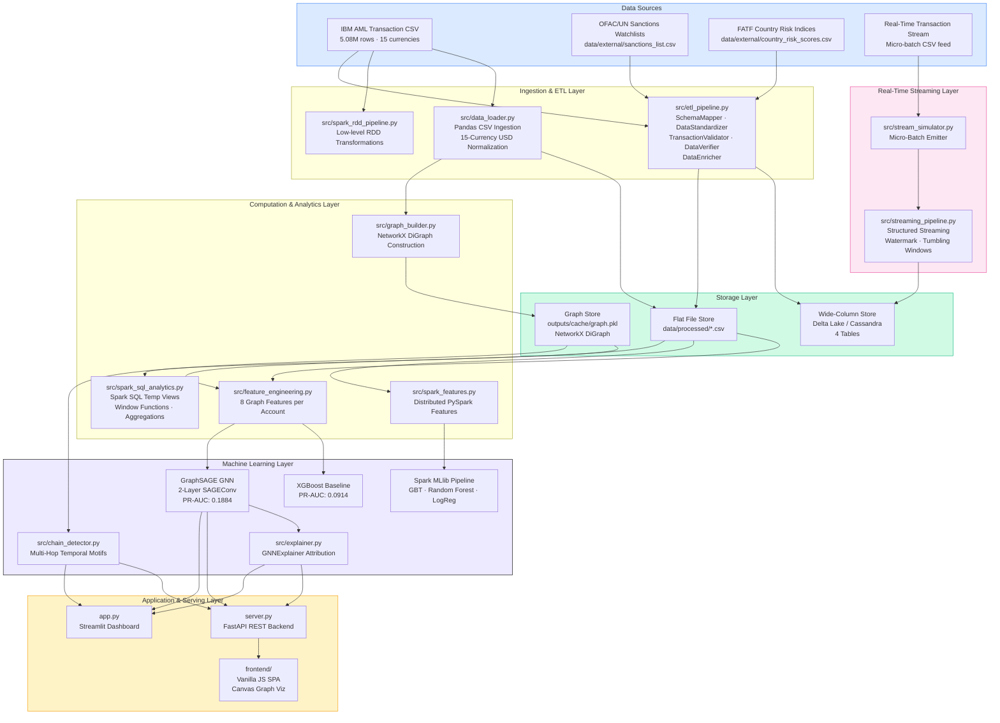
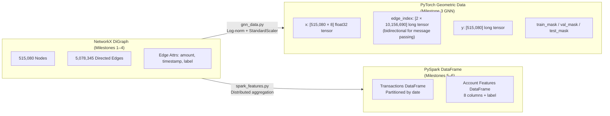
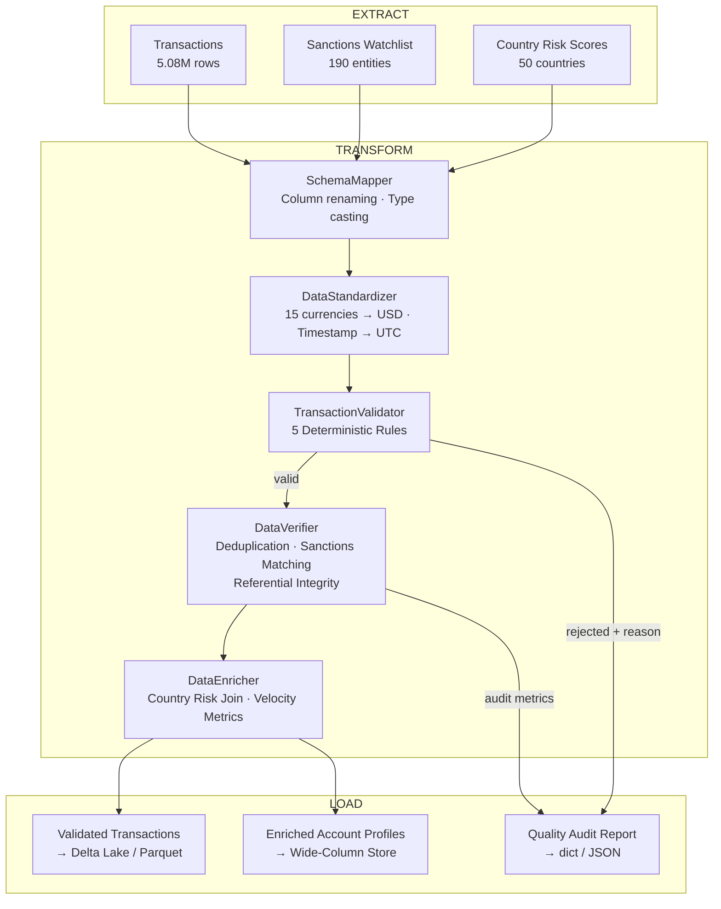
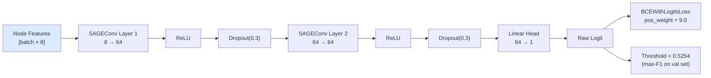
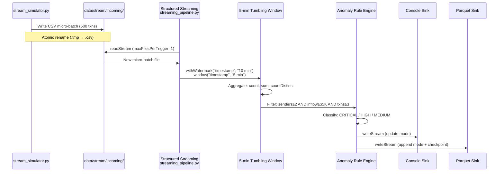
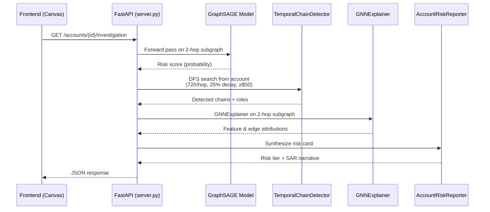

# Chain Reaction — System Architecture

> Money Mule Detection with Graph Neural Networks, Distributed Spark Processing, and Wide-Column NoSQL Storage

---

## 1. High-Level Architecture



---

## 2. Data Architecture & Storage Model

This is the central design concern of the system. The project uses a **polyglot persistence** strategy — each storage engine is chosen for the access pattern it serves best.

### 2.1 Storage Engine Summary

| Store | Engine | Location | Purpose | Access Pattern |
|:---|:---|:---|:---|:---|
| **Raw Ledger** | Flat CSV | `data/raw/HI-Small_Trans.csv` | Immutable transaction archive (5.08M rows, 453 MB) | Batch-read for ETL |
| **Processed Ledger** | Flat CSV | `data/processed/processed_df.csv` | Cleaned, USD-normalized transactions (604 MB) | Batch-read for features |
| **Account Feature Store** | Flat CSV | `data/processed/account_features.csv` | 8 precomputed graph features for 515,080 accounts | Train/test/inference lookup |
| **Split Mapping** | Flat CSV | `data/processed/split_accounts.csv` | Deterministic 70/10/20 train/val/test partition | Consistency across milestones |
| **Graph Cache** | Pickle (NetworkX) | `outputs/cache/graph.pkl` | Serialized DiGraph (89.7 MB, ~515K nodes, ~5M edges) | In-memory graph algorithms |
| **PyG Tensor Store** | In-Memory | Runtime | Edge index, node features, masks as PyTorch tensors | GNN training & inference |
| **Model Registry** | JSON / PT | `outputs/models/` | XGBoost (`model.json`) and GraphSAGE (`graphsage.pt`) | Model loading at serve time |
| **Wide-Column Store** | Delta Lake / Cassandra | `outputs/wide_column_store/` | Time-partitioned events, wide-row profiles, alert logs | Production-scale queries |
| **External Reference Data** | Flat CSV | `data/external/` | Sanctions watchlists and country risk scores | ETL enrichment joins |

### 2.2 Data Flow Through Storage Layers

```mermaid
flowchart LR
    RAW["HI-Small_Trans.csv<br/><i>5.08M rows · 15 currencies</i><br/>453 MB"] -->|data_loader.py<br/>Currency → USD| PROC["processed_df.csv<br/><i>Cleaned · USD-normalized</i><br/>604 MB"]
    
    PROC -->|graph_builder.py<br/>Edge iteration| GRAPH["graph.pkl<br/><i>NetworkX DiGraph</i><br/>515K nodes · 5M edges<br/>89.7 MB"]
    
    PROC & GRAPH -->|feature_engineering.py<br/>Degree, PageRank, Holding Time| FEATS["account_features.csv<br/><i>8 features × 515,080 accounts</i><br/>37.8 MB"]
    
    FEATS -->|splits.py<br/>Stratified split| SPLITS["split_accounts.csv<br/><i>70% train · 10% val · 20% test</i><br/>8.15 MB"]
    
    FEATS & SPLITS & PROC -->|gnn_data.py<br/>Log-norm · StandardScaler| PYG["PyG Data<br/><i>x: [515K, 8] · edge_index: [2, 10.2M]</i><br/>In-memory tensors"]
    
    PYG -->|gnn_model.py<br/>SAGEConv · NeighborLoader| MODEL["graphsage.pt<br/><i>Best checkpoint</i><br/>41 KB"]

    style RAW fill:#fee2e2,stroke:#ef4444
    style PROC fill:#fef3c7,stroke:#f59e0b
    style GRAPH fill:#d1fae5,stroke:#10b981
    style FEATS fill:#dbeafe,stroke:#3b82f6
    style PYG fill:#ede9fe,stroke:#8b5cf6
    style MODEL fill:#ede9fe,stroke:#8b5cf6
```



---

## 3. Wide-Column Database Design (Primary Data Model)

> [!IMPORTANT]
> The wide-column model is the production-target data architecture for this system. It is designed for Cassandra (CQL specification in [`docs/cassandra_schema.cql`](cassandra_schema.cql)) and implemented on Delta Lake for Databricks Community Edition compatibility ([`src/wide_column_model.py`](../src/wide_column_model.py)).

### 3.1 Why a Wide-Column Store

Anti-money laundering workloads have three defining characteristics that make wide-column databases the optimal storage choice:

1. **High write throughput**: Transaction event ingestion runs at sustained high volume (millions of events per day per institution). Cassandra's log-structured merge (LSM) tree storage is append-optimized with no read-before-write penalty.

2. **Time-series access patterns**: The dominant query pattern is *"fetch the N most recent transactions for account X"* — a single-partition, clustering-key-ordered scan. Wide-column stores co-locate all data for a partition key on the same node and store clustering keys in sorted order on disk, making this a contiguous sequential read.

3. **Schema-flexible feature evolution**: As new ML models and graph features are developed (XGBoost → GraphSAGE → Spark GBT → ensemble), their scores must be added to account profiles without downtime or full-table rewrites. Wide-column stores support `ALTER TABLE ADD` with zero storage overhead for accounts that don't yet have values.

### 3.2 Keyspace & Table Design

```mermaid
erDiagram
    TRANSACTION_EVENTS {
        TEXT account_id PK "Partition Key"
        TIMESTAMP event_timestamp CK "Clustering Key 1 (DESC)"
        UUID transaction_id CK "Clustering Key 2"
        TEXT direction "IN or OUT"
        TEXT counterparty_account
        DOUBLE amount_usd
        TEXT original_currency
        DOUBLE original_amount
        TEXT payment_format
        INT is_laundering
    }

    ACCOUNT_PROFILES {
        TEXT account_id PK "Primary Key"
        INT in_degree
        INT out_degree
        DOUBLE total_in_usd
        DOUBLE total_out_usd
        DOUBLE avg_holding_time_sec
        BOOLEAN has_outflow_after_inflow
        INT unique_counterparties
        DOUBLE pagerank
        INT fan_in_count
        INT fan_out_count
        DOUBLE txn_velocity_per_hour
        DOUBLE cross_currency_ratio
        INT unique_currencies
        BOOLEAN is_sanctioned
        TEXT sanctions_program
        TEXT jurisdiction_code
        DOUBLE jurisdiction_risk_score
        DOUBLE xgboost_risk_score
        DOUBLE graphsage_risk_score
        DOUBLE spark_gbt_risk_score
        DOUBLE combined_risk_score
        TEXT risk_level
        TIMESTAMP first_seen
        TIMESTAMP last_seen
        TIMESTAMP last_model_update
    }

    STREAMING_ALERTS {
        DATE alert_date PK "Partition Key"
        TIMESTAMP alert_timestamp CK "Clustering Key 1 (DESC)"
        TEXT account_id CK "Clustering Key 2"
        TEXT alert_level
        TEXT trigger_rule
        INT txn_count
        DOUBLE total_inflow_usd
        INT unique_senders
        TIMESTAMP window_start
        TIMESTAMP window_end
        BOOLEAN acknowledged
    }

    MODEL_PREDICTIONS {
        TEXT account_id PK "Partition Key"
        TIMESTAMP prediction_timestamp CK "Clustering Key 1 (DESC)"
        TEXT model_name CK "Clustering Key 2"
        TEXT model_version
        DOUBLE risk_score
        DOUBLE decision_threshold
        BOOLEAN is_mule_predicted
        TEXT explanation_summary
        TEXT features_snapshot
    }

    ACCOUNT_PROFILES ||--o{ TRANSACTION_EVENTS : "account_id"
    ACCOUNT_PROFILES ||--o{ MODEL_PREDICTIONS : "account_id"
    STREAMING_ALERTS }o--|| ACCOUNT_PROFILES : "account_id"
```

### 3.3 Table-by-Table Design Rationale

#### Table 1: `transaction_events` — Time-Series Event Journal

| Attribute | Value | Rationale |
|:---|:---|:---|
| **Partition Key** | `account_id` | Every event for an account (both sent and received) lands in a single partition. Enables O(1) node lookup to reconstruct ego-subgraphs for the UI graph visualization. |
| **Clustering Keys** | `event_timestamp DESC`, `transaction_id ASC` | Sorts events latest-first within each account partition. The most common compliance query — *"show me the 20 most recent transactions for this flagged account"* — becomes a contiguous disk read with no sorting. `transaction_id` breaks timestamp ties. |
| **TTL** | 31,536,000s (1 year) | Regulatory retention. Expired rows are garbage-collected during compaction, avoiding explicit DELETE tombstone overhead. |
| **Compaction** | `TimeWindowCompactionStrategy` (1-day windows) | Aligns compaction windows with the temporal clustering order. Prevents old SSTables from being rewritten when only new events are arriving. |
| **Denormalization** | `direction`, `counterparty_account`, `original_currency` stored per event | Wide-column stores do not support JOINs. Each row is self-contained so that a single partition scan returns all information the compliance UI needs without secondary lookups. |

**Primary query patterns:**
```sql
-- Ego-subgraph for account investigation (partition scan, LIMIT)
SELECT * FROM transaction_events WHERE account_id = ? LIMIT 20;

-- Time-range filter within an account (clustering key range)
SELECT * FROM transaction_events
WHERE account_id = ? AND event_timestamp >= ? AND event_timestamp <= ?;
```

#### Table 2: `account_profiles` — Wide-Row Feature & Score Store

| Attribute | Value | Rationale |
|:---|:---|:---|
| **Partition Key** | `account_id` (single column PK) | One wide row per account. All features, ML scores, regulatory flags, and collection columns are co-located. |
| **Column Groups** | 8 topological features, 5 behavioral signals, 4 regulatory flags, 4 ML scores, 3 timestamps, 4 collection columns | This is the canonical wide-column pattern: a single entity with 30+ columns representing its complete analytical state. |
| **Collection Columns** | `LIST<DOUBLE>`, `SET<TEXT>`, `MAP<TEXT, DOUBLE>` | `last_10_txn_amounts` for rolling inference, `flagged_chain_ids` for detected motifs, `counterparty_risk_map` for peer risk. These avoid the need for separate child tables. |
| **Schema Evolution** | `ALTER TABLE ADD` for new ML model scores | When a new model (e.g., Spark MLlib GBT) is deployed, its score column is added without altering existing rows. Unset columns consume zero storage in Cassandra. |
| **Compaction** | `LeveledCompactionStrategy` | Optimized for read-heavy workloads (account lookup is the primary access pattern). Reduces read amplification compared to SizeTiered. |

**Primary query patterns:**
```sql
-- Single account lookup (primary key, O(1) hash lookup)
SELECT * FROM account_profiles WHERE account_id = ?;

-- High-risk triage via materialized view
SELECT * FROM high_risk_accounts
WHERE risk_level = 'CRITICAL' ORDER BY combined_risk_score DESC LIMIT 50;
```

**Secondary index and materialized view:**
- `account_risk_level_idx` on `risk_level` — enables `WHERE risk_level = 'CRITICAL'` queries without full table scans.
- `high_risk_accounts` materialized view — pre-sorted by `(risk_level, combined_risk_score DESC)` for instant compliance triage.

#### Table 3: `streaming_alerts` — Real-Time Anomaly Alert Log

| Attribute | Value | Rationale |
|:---|:---|:---|
| **Partition Key** | `alert_date` (DATE) | Day-bucketed partitions. A compliance team reviewing today's alerts reads a single partition. Prevents unbounded partition growth. |
| **Clustering Keys** | `alert_timestamp DESC`, `account_id ASC` | Latest alerts first. Each day's alerts are ordered chronologically, ensuring the triage queue surfaces the most recent critical events at the top. |
| **TTL** | 7,776,000s (90 days) | Alert retention window for regulatory compliance reporting. |
| **Columns** | `alert_level`, `trigger_rule`, `txn_count`, `total_inflow_usd`, `unique_senders`, `window_start/end` | Each alert is self-describing — the rule that fired, the aggregation metrics that triggered it, and the streaming window boundaries. |

**Primary query pattern:**
```sql
-- Today's critical and high-severity alerts
SELECT * FROM streaming_alerts
WHERE alert_date = toDate(now()) AND alert_level IN ('CRITICAL', 'HIGH')
LIMIT 50;
```

#### Table 4: `model_predictions` — Immutable Audit Trail

| Attribute | Value | Rationale |
|:---|:---|:---|
| **Partition Key** | `account_id` | All predictions for one account form a historical lineage in a single partition. |
| **Clustering Keys** | `prediction_timestamp DESC`, `model_name ASC` | Latest prediction first. Multiple models scored at the same timestamp are grouped alphabetically. |
| **Columns** | `model_version`, `risk_score`, `decision_threshold`, `is_mule_predicted`, `explanation_summary`, `features_snapshot` (JSON) | Complete model governance audit record: what model version scored what risk, at what threshold, with what features and what explanation. Required for SAR (Suspicious Activity Report) filings. |

**Primary query pattern:**
```sql
-- Full prediction history for regulatory SAR narrative
SELECT model_name, prediction_timestamp, risk_score, is_mule_predicted, explanation_summary
FROM model_predictions WHERE account_id = ?;
```

### 3.4 Delta Lake Implementation (Databricks CE)

Since Databricks Community Edition cannot connect to external Cassandra clusters, the wide-column schema is implemented using Delta Lake with equivalent semantics:

| Cassandra Concept | Delta Lake Equivalent | Implementation |
|:---|:---|:---|
| Partition Key | `partitionBy("txn_date")` | Physical directory partitioning in `outputs/wide_column_store/` |
| Clustering Order | Sorted writes + Z-Ordering | `.sort("timestamp", ascending=False)` before `.write` |
| Dynamic Columns | `mergeSchema = true` | Schema evolution via `ALTER TABLE ADD COLUMNS` or `option("mergeSchema", "true")` |
| Lightweight Upserts | `MERGE INTO ... WHEN MATCHED THEN UPDATE` | Delta ACID merge for updating account profiles with new ML scores |
| TTL Expiry | Manual `DELETE WHERE timestamp < ...` | Scheduled purge (no native TTL in Delta) |
| Time Travel | `VERSION AS OF N` / `DESCRIBE HISTORY` | Built-in Delta Lake versioning for regulatory audit |
| Materialized View | Spark SQL `CREATE VIEW` | Temp views filtering on `risk_level` |

### 3.5 Wide-Column vs. Relational: Design Decisions

> [!NOTE]
> The following design trade-offs explain why a relational (PostgreSQL/MySQL) schema was **not** chosen for the production data model.

| Concern | Relational Approach | Wide-Column Approach (Chosen) |
|:---|:---|:---|
| **Schema changes** | `ALTER TABLE` locks the table; adding 5 new ML score columns requires migration scripts and downtime | `ALTER TABLE ADD` is instant and lock-free; unset columns use zero storage |
| **Time-series queries** | Requires composite index `(account_id, timestamp DESC)`, B-tree seeks | Clustering key `(event_timestamp DESC)` is the physical sort order — sequential read |
| **Write throughput** | Write-ahead log + B-tree page splits; ~10K writes/sec per node | LSM-tree append-only; ~50K+ writes/sec per node |
| **JOINs** | Natural strength — `JOIN transactions ON account_id` | No JOINs — data is **denormalized at write time** (each event row is self-contained) |
| **Aggregations** | `GROUP BY` with hash/sort aggregation | Aggregations happen in Spark (batch ETL), not in the storage engine |
| **Consistency** | Strong (ACID per transaction) | Tunable consistency (ONE to QUORUM); eventual consistency is acceptable for ML feature stores |
| **Horizontal scaling** | Vertical scaling primary; read replicas for reads | Linear horizontal scaling via consistent hashing (vnode ring) |

---

## 4. Graph Data Model

The transaction network is modeled as a **directed graph** $G = (V, E)$ where:

- **Nodes** ($V$): 515,080 unique bank accounts (string identifiers)
- **Edges** ($E$): 5,078,345 directed transactions from sender → receiver
- **Edge attributes**: `amount_usd` (float), `timestamp` (datetime), `is_laundering` (binary)

### 4.1 Graph Representations



### 4.2 Account Feature Schema (8 Dimensions)

| # | Feature | Type | Computation | AML Signal |
|:---|:---|:---|:---|:---|
| 1 | `in_degree` | int | Count of inbound transactions | Fan-in accumulation |
| 2 | `out_degree` | int | Count of outbound transactions | Fan-out distribution |
| 3 | `total_in` | float | Sum USD received | Volume magnitude |
| 4 | `total_out` | float | Sum USD sent | Pass-through balance |
| 5 | `pagerank` | float | Amount-weighted `nx.pagerank()` | Network centrality / bottleneck |
| 6 | `avg_holding_time` | float | Mean seconds between receive → forward | Dwell time (low = mule) |
| 7 | `has_outflow_after_inflow` | binary | 1 if account forwarded after receiving | Pass-through indicator |
| 8 | `unique_counterparties` | int | \|senders ∪ receivers\| | Dispersion breadth |

**Normalization pipeline** (applied in [`src/gnn_data.py`](../src/gnn_data.py)):
1. Heavy-tailed features → $\log(1 + x)$ transform
2. PageRank → rescale by $N$ then $\log(1 + \text{pr} \times N)$ (values sum to 1 over 515K nodes, ~2×10⁻⁶ average)
3. `StandardScaler` fit **exclusively on the training split** to prevent data leakage

---

## 5. ETL & Data Quality Architecture



### 5.1 Validation Rules

| # | Rule ID | Check | Action |
|:---|:---|:---|:---|
| 1 | `NULL_REQUIRED_FIELD` | `from_account`, `to_account`, `timestamp`, `amount_paid_usd` not null | **Reject** |
| 2 | `NON_POSITIVE_AMOUNT` | `amount_paid_usd > 0` and `amount_received_usd > 0` | **Reject** |
| 3 | `SELF_TRANSFER` | `from_account ≠ to_account` | **Reject** |
| 4 | `FUTURE_TIMESTAMP` | `timestamp ≤ current_timestamp()` | **Reject** |
| 5 | `AMOUNT_OUTLIER` | `amount_paid_usd > μ + 3σ` | **Flag** (not rejected) |

---

## 6. Machine Learning Architecture

### 6.1 Model Comparison

| Model | Framework | Architecture | Val PR-AUC | Test PR-AUC |
|:---|:---|:---|:---|:---|
| Random Floor | — | — | 0.0123 | 0.0123 |
| XGBoost (M2) | xgboost | 8 features, `scale_pos_weight=80` | — | 0.0914 |
| XGBoost (M3) | xgboost | 8 features, val-tuned threshold | 0.0855 | 0.0834 |
| **GraphSAGE (M3)** | PyTorch Geometric | 2-layer SAGEConv, 64-dim, NeighborLoader(15,10) | **0.2091** | **0.1884** |
| Spark GBT (M6C) | pyspark.ml | GBTClassifier, CrossValidator | — | TBD |
| Spark RF (M6C) | pyspark.ml | RandomForestClassifier | — | TBD |

### 6.2 GraphSAGE GNN Architecture



**Training configuration:**
- Neighbor sampling: (15, 10) neighbors per layer, `batch_size=2048`
- Optimizer: Adam with `ReduceLROnPlateau` scheduler
- Early stopping on validation PR-AUC, `patience=5`
- Bidirectional edges added in [`gnn_data.py`](../src/gnn_data.py) (total: 2 × 5,078,345 = 10,156,690 directed edges)

---

## 7. Real-Time Streaming Architecture



---

## 8. Serving Architecture

### 8.1 FastAPI Backend (`server.py`)

| Endpoint | Method | Purpose |
|:---|:---|:---|
| `/api/v1/telemetry` | GET | System health, model metrics, dataset statistics |
| `/api/v1/accounts/search` | GET | Autocomplete account search (query param `q`) |
| `/api/v1/accounts/{id}/investigation` | GET | Full AML investigation: GNN score, chain detection, GNNExplainer, risk card |
| `/api/v1/accounts/{id}/subgraph` | GET | 2-hop ego-network nodes and edges for canvas graph visualization |
| `/api/v1/benchmarks` | GET | Cross-model PR-AUC comparison data |
| `/` | GET | Serves `frontend/index.html` |

### 8.2 Runtime Pipeline (on account investigation request)



---

## 9. Directory Structure

```
chain-reaction/
├── data/
│   ├── raw/                         # Immutable Kaggle dataset
│   │   └── HI-Small_Trans.csv       # 5.08M transactions, 453 MB
│   ├── processed/                   # ETL outputs
│   │   ├── processed_df.csv         # USD-normalized transactions, 604 MB
│   │   ├── account_features.csv     # 8 features × 515K accounts, 37.8 MB
│   │   └── split_accounts.csv       # Deterministic 70/10/20 split, 8.15 MB
│   ├── external/                    # Multi-source enrichment data
│   │   ├── sanctions_list.csv       # Simulated OFAC/UN watchlist, 190 entities
│   │   └── country_risk_scores.csv  # FATF risk indices, 50 countries
│   └── stream/                      # Structured Streaming directories
│       ├── incoming/                # Micro-batch CSV drop zone
│       ├── output/                  # Parquet alert sink
│       └── checkpoints/            # Streaming checkpoint metadata
│
├── docs/                            # Architecture & design documentation
│   ├── ARCHITECTURE.md              # This document
│   ├── MILESTONES.md                # 6-milestone project roadmap
│   ├── DESIGN.md                    # UI design system specification
│   ├── DATABASE_SHOWCASE_GUIDE.md   # Executive presentation & showcase cheat sheet
│   └── cassandra_schema.cql         # Production Cassandra CQL schema
│
├── scripts/                         # Interactive CLI utilities
│   ├── showcase_db.py               # Interactive database presentation tour
│   └── run_single_notebook.py       # Headless notebook execution runner
│
├── src/                             # Core source modules
│   ├── data_loader.py               # CSV ingestion, 15-currency USD standardization
│   ├── graph_builder.py             # NetworkX DiGraph construction & caching
│   ├── feature_engineering.py       # 8 per-account graph features (vectorized pandas)
│   ├── splits.py                    # Stratified train/val/test split generator
│   ├── gnn_data.py                  # PyG Data object: tensors, log-norm, StandardScaler
│   ├── gnn_model.py                 # GraphSAGE architecture, training, evaluation
│   ├── chain_detector.py            # Multi-hop temporal motif DFS search
│   ├── explainer.py                 # GNNExplainer feature & edge attribution
│   ├── risk_report.py               # Analyst Risk Cards & SAR narrative generation
│   ├── spark_features.py            # PySpark DataFrame feature engineering
│   ├── spark_rdd_pipeline.py        # Explicit RDD transformations & actions
│   ├── spark_sql_analytics.py       # Spark SQL temp views & window analytics
│   ├── spark_ml_pipeline.py         # Distributed MLlib classification suite
│   ├── etl_pipeline.py              # Multi-source ETL with validation & enrichment
│   ├── stream_simulator.py          # Micro-batch transaction event emitter
│   ├── streaming_pipeline.py        # Structured Streaming anomaly detector
│   └── wide_column_model.py         # Delta Lake wide-column implementation
│
├── notebooks/                       # Jupyter/Databricks notebooks
│   ├── 01–05 (Milestones 1–5)       # Original project notebooks
│   ├── 06a–06g (Milestone 6)        # Big data enhancement suite
│   └── 07_database_showcase.ipynb   # Interactive DB architecture & query showcase
│
├── outputs/                         # Generated artifacts (git-ignored)
│   ├── cache/graph.pkl              # Serialized NetworkX DiGraph
│   ├── figures/                     # PR curves, training curves, risk cards
│   ├── models/                      # XGBoost (model.json), GraphSAGE (graphsage.pt)
│   ├── results/                     # Evaluation benchmark CSVs
│   └── wide_column_store/           # Delta Lake physical tables
│
├── frontend/                        # Vanilla JS SPA (HTML5 Canvas graph viz)
│   ├── index.html                   # 1,071 lines, full SPA structure
│   ├── app.js                       # 3,525 lines, canvas physics, API integration
│   └── style.css                    # 88 KB, dark/light design system
│
├── app.py                           # Streamlit AML compliance dashboard
├── server.py                        # FastAPI REST backend (serves frontend)
├── requirements.txt                 # Python dependencies
└── README.md                        # Project overview & quick start
```

